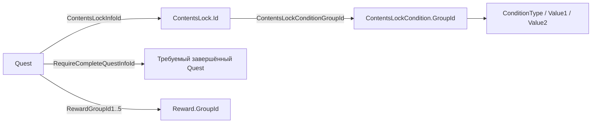

# ContentsLock: условия открытия квестов и связи с наградами

15 октября 2026. Читать после [главного файла разработки](../../vampir/README.md).
Исследование файлов установленного клиента, без действий на телефоне.

**Обновление:** нативный конвертер теперь подтвердил имена11 числовых типов;
Type1 — CompletedQuest. См. [CONDITION-TYPES.md](CONDITION-TYPES.md) и
quest-graph/condition-types.json. Ниже сохранены границы прежнего соединения
таблиц; числовые сравнения и объединение условий по-прежнему не восстановлены.

## Подтверждённые источники

Архив: `pakchunk1-Windows.pak`, CSV находятся в библиотеке
`F:/PhoneExit Resources/Vampir/table-study`.

| Запись | Назначение | Строк |
|---:|---|---:|
| 69 | ContentsLock | 269 |
| 70 | ContentsLockCondition | 330 |
| 1448 | Quest, включая ContentsLockInfoId и RewardGroupId1..5 | 1353 |
| 1454 | QuestTask, условия задачи и параметры | 5944 |
| 1475 | Reward | 96102 |

У загрузчиков в EXE есть строки `ContentsLockCondition.csv` (160659040),
`FRdContentsLockConditionInfoManagerTemplate::Load` (160659136),
`ContentsLock.csv` (160660144), `FRdContentsLockInfoManagerTemplate::Load`
(160660224). Полная диагностическая строка по смещению 160661442 объявляет
ContentsLock.ContentsLockConditionGroupId → ContentsLockCondition.
Это файловые смещения строк, не адреса функций.
Хеш исходного EXE — в CODE-CLUES.md; SHA256 CSV, PAK и смещения записей —
в разделе sources каждого отчёта. Исходное имя CSV восстановлено по загрузчику
и схеме; зашифрованный индекс PAK не расшифровывался.

## Восстановленные соединения



`build-reward-links.py` проверяет SHA256 входов и формирует:

- `quest-graph/contents-locks.json`: все 269 блокировок, их условия,
  109 ссылок квестов, результаты проверок и ограничения интерпретации;
- `quest-graph/rewards.json`: квесты, требования, ContentsLock и группы наград;
- `quest-graph/early-unlock-chain.json`: исходные строки рассматриваемой ранней цепочки.

Отсутствующих ContentsLock по ссылкам квестов — 0. Отсутствующих групп условий
для всех 269 блокировок — 0. Для 51 из 109 ссылок квестов в группе одна строка,
для 58 — две. Логика AND/OR не установлена: порядок и строки сохранены как есть.
Также сохранены SaveType, ServerServiceGroupId, OpenNotification,
SystemMessageNotify, OverrideCollapsed, ContentBP, ContentsWidgetLockUI,
ContentsWidget и другие поля, потенциально относящиеся к доступности UI.
Их исполняемая семантика отдельно не восстановлена.

## Конкретный барьер основного квеста

Quest **110540 — Meeting the Bookseller**:

- PreQuestId = 110530;
- RequireCompleteQuestInfoId = **901030**;
- задачи 110540010/020 содержат переход и диалог.

Quest **901030 — [Guide] Importance of Supplies**:

- ContentsLockInfoId = **10100030**;
- ContentsLock 10100030 → группа 10100030 → условие Id 199;
- ConditionType = **1**, ConditionTypeValue1 = **901010**, Value2 = 0;
- задача **901030010**, Type = 27, исходный Param:

```json
{"npcSpawnInfoId":1101101,"interactionType":"MoveContents","shopCategoryInfoId":3,"count":1}
```

Это конкретные параметры магазинной задачи, а не условие «забрать все награды».
Type=27 теперь подтверждён как EQuestTaskType::NpcShopBuy массивом native enum.
Точные условия счётчика ещё требуют проверки обработчика.
В Param не заданы конкретный товар и цена, поэтому автоматический выбор покупки
по этим данным пока не реализован. Дополнительно найденная категория магазина
(CSV 1500, Id 3) содержит ShopType=5 и ShowInAppBilling=0; это не определяет
валюту и цену конкретного товара.

Quest **901010 — [Guide] Complete Main Quest**:

- ContentsLockInfoId = **10100010**;
- его условие Id 198: Type=1, Value1=**110190**, Value2=0;
- задача 901010010 содержит `questType: Scenario`, `questInfoId: 110520`.

Имена: 110190 — Into the Nest, 110520 — The Elder of Krvna,
110530 — Meeting the General Merchant. Утверждение, что 901030 является
обучением Bloodshape, неверно: Bloodshape — Tutorial 4009 внутри 110530.

## Что ещё нельзя вычислять автоматически

Частоты ConditionType в исходных 330 строках: 0 — 117, 1 — 145,
3 — 2, 4 — 41, 7 — 19, 8 — 1, 9 — 5.
У Type=1 141 из 145 Value1 совпали с Id в Quest. Это сильная зацепка ссылки
на квест. Теперь имя типа подтверждено конвертером как CompletedQuest;
сама проверка состояния и операции Value1/Value2 ещё не разобраны.
Нельзя применять условие как готовый evaluator только по имени типа и совпадению ID.

Не сопоставились четыре строки: блокировки 10800025 → 908020,
10800040 → 908030, 10800050 → 908030, 10800160 → 908150.
Этих трёх ID нет ни в Quest 1448, ни в проверенной английской локализации 498.
Причина неизвестна: это не доказательство ошибки игры и не разрешение обхода.

Данные персонажа не считывались, истинность условий не вычислялась.
Сравнение чисел, SaveType, серверные группы и объединение условий остаются
следующим предметом разбора. Подготовленные связи пока исследовательские:
в уже установленном модуле 1.0.7 новый evaluator не появился.

Проверки: отклонение дубликатов ID, сохранение всех условий и исходных флагов,
различение отсутствующей и необъявленной группы, запрет подразумеваемого AND/OR.
Актуальный целевой прогон test_vampir*.py — **163 теста**, все прошли.
Типы задач и товаров описаны в [NATIVE-SEMANTICS.md](NATIVE-SEMANTICS.md).
Это не восстанавливает автоматически семантику ContentsLockCondition.
