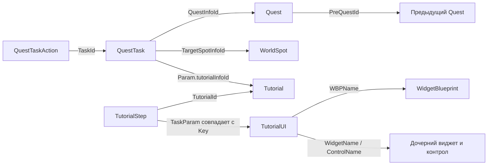

# Vampir: зависимости квестов, обучения и интерфейса

Проверено 15 октября 2026 на ресурсах установленного клиента Windows.
Сопоставление с версией данных Android ещё не завершено. Бот пока не использует
этот граф для определения текущего задания; автоматического чтения состояния
персонажа из клиента нет.

## Где данные

Библиотека: `F:/PhoneExit Resources/Vampir`.

| Данные | Запись pakchunk1-Windows | Количество |
|---|---:|---:|
| Quest | 1448 | 1353 |
| QuestTask | 1454 | 5944 |
| QuestTaskAction | 1455 | 3892 |
| Tutorial | 1551 | 26 |
| TutorialStep | 1555 | 139 |
| TutorialUI | 1556 | 94 |
| WorldSpot | 1573 | 588 |
| Quest_Name, английский | 498 | 1689 |
| QuestTask_Name, английский | 502 | 8339 |
| TutorialStep_Name, английский | 543 | 55 |

Последнее количество локализованных строк сверять с индексом CSV, а не
использовать как количество активных заданий. Переводы содержат строки,
которых может не быть в активной таблице текущей версии.

Индекс происхождения: `table-study/index-pakchunk1-Windows.json`.
Содержит исходный PAK, смещение, номер записи, SHA256 и заголовок каждого CSV.
В графе `provenance.csv_record` — логический номер CSV-записи с учётом заголовка,
не номер физической строки: параметры могут содержать многострочный JSON.

## Подтверждённые связи

Первые связи также объявлены полными корейскими сообщениями проверки ссылок
в EXE: `code-clues/table-dependencies.json` — 619 объявлений, среди них
31 от таблиц квестов, обучения и выбранных таблиц мира.
Полные исходные сообщения и смещения сохранены. Это декларации связей,
а не результат выполнения каждого квеста.

По строкам данных выполнены соединения квестов, задач, действий, точек,
обучения, английских текстов и ключей интерфейса. У всех токенов PreQuestId
найдены целевые квесты; семантика нескольких предшественников не угадывается.
50 шагов имеют прямое совпадение TaskParam с ключом TutorialUI,
55 шагов имеют английскую подсказку.

Для 93 из 94 UI-ключей найдены соответствующие WBP среди ресурсов.
Для 35 ключей именованный контрол найден непосредственно в экспортах корневого
WBP. Остальные могут обращаться к дочернему WidgetName; это не доказательство
отсутствия кнопки. Не найден корневой WBP для DisassembleMode_DisassembleFilterPopup.
Обновлённый `ui-layout-study/index.json`: 81 разобранный пакет, 0 ошибок.
Геометрия layout по-прежнему не декодирована.

## Пример: Drain, который уже видели на телефоне

Quest 110130, английское имя **Chase the mercenary**, PreQuestId 110120.
QuestTask 110130040: Param содержит `tutorialInfoId: 4002`.

| Шаг TutorialStep | TaskParam | Цель TutorialUI |
|---|---|---|
| 4002004 | Deadly_Target | WBP_InteractionDeadlyNPCT / ButtonInteraction |
| 4002006 | Hud_Menu | WBP_GameUI / MenuBarUI / ButtonMenu |
| 4002008 | Menu_Skill | WBP_MainMenuUI / CanvasPanelSkill / ButtonSkill |
| 4002010 | SkillSetting_SecondSkill_Select | WBP_SkillSettingPopup / TableViewSkillList |
| 4002012 | Skill_Tooltip | WBP_SkillEffectInfoT / CanvasPanelTutorial |
| 4002013 | SkillSetting_SecondSkill_Auto | WBP_SkillSettingPopup / TableViewSkillList / ButtonAuto |
| 4002014 | SkillSetting_Close | WBP_SkillSettingPopup / ButtonClose |
| 4002016 | Deadly_AdrenalineGauge | WBP_GameUI / CanvasPanelAdrenaline / ButtonAdrenalineGauge |
| 4002018 | Deadly_AdrenalineTooltip | WBP_AdrenalineGaugeToolTipUI / CanvasPanelRoot / CanvasPanelTutorial |

Между ними есть отдельные строки TaskType=4 с TaskParam: 0.5, 4.5, 0.3,
0.3, 0.1, 0.1, 0.2. Это численные значения из таблицы; интерпретация как ожиданий
согласуется с расположением между UI-шагами, но реализация TaskType ещё не
декомпилирована. В 1.0.4 значения после 12 зарегистрированных действий используются
как минимум ожидания. При меньшем значении сохранена защитная задержка 2 с.
Миллисекундная точность при текущем цикле распознавания не заявляется.
ServerProcessRequest и флаги SkipButtonMove/Hide, ArrowHide, CloseAllPopUp
сохранены без изменения. Нельзя превращать все строки в безусловные клики.

## Пример: первая экипировка

Quest 110150 **To a safe location** → задача 110150070 → Tutorial 4003.
В нём указаны Hud_Inventory → Inventory_EquipmentItem_Class1 → ItemInfoPopup_Equip.
Для предмета задан TargetId: `11041002, 11031002, 11021002, 11011002, 11051001`;
нельзя выбирать произвольный первый предмет сумки вместо этих целей.
Для Equip целевой контрол — WBP_ItemInfoPopup.ButtonEquip.

## Проверки и ограничения

Дополнение 15 октября: числа EQuestType, EQuestTaskType, EActionType и
EActionConditionType теперь сопоставлены с именами по массивам дескрипторов
собранного EXE. `build-quest-graph.py` сохраняет имена и native_enum_source;
неизвестных использованных типов 0. NpcShopBuy=27 и CompleteQuest=25 доказаны.
Это не относится к числам Tutorial TaskType или ContentsLockCondition.
См. [NATIVE-SEMANTICS.md](NATIVE-SEMANTICS.md).

`build-quest-graph.py` проверяет SHA256 входных CSV, обязательные колонки и число
записей. Сохраняет исходные строки и все ошибки разбора, не исправляя игровые
данные самостоятельно. У 20 параметров из этих таблиц строгий JSON-разбор
не прошёл; исходный текст сохранён в графе, причины в json_parse_errors.
Это ограничение нашего парсера, а не вывод о поломке игры.

Дополнительная проверка validation.json: все 5944 задачи ссылаются на имеющиеся
квесты; все 139 учебных шагов — на имеющееся обучение; неизвестных предшественников
квестов 0. Проверены SHA256 всех 1565 CSV. Полный поиск охватил 106 архивов
и 149004 незашифрованные записи подходящего размера, ошибок декодирования 0.

`quest-graph/index.json` — справочный граф; `early-quests.json` содержит
110110, 110130 и 110150. Координаты QuestActionPos/WorldSpot извлечены, но
преобразование в пиксели карты и допустимые действия телефона не проверены.
Не считать предполагаемую стадию текущим состоянием без проверки экрана.

## Ограниченное использование графа в 1.0.4

`build-tutorial-bindings.py` сопоставляет 12 пар подсказка/цель с точными
TutorialStep и TutorialUI. В модуле tutorial-reference.json хранит хеши и
смещения CSV. activePoint показывает `last_tutorial:<TutorialId>:step:<Step>`:
последний наблюдавшийся шаг, а не серверное состояние. При возврате к HUD поле
очищается. Запись в таблице или прошлый шаг сами по себе не разрешают нажатие.
